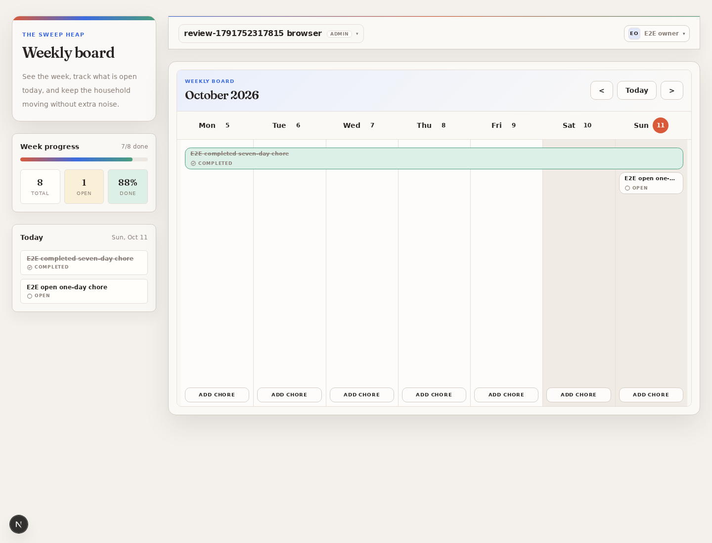

# Whole-project review, 2026-10-11

This is a historical evidence snapshot of the reviewed baseline. GitHub Issues track fixes and current
status. The ten primary bug findings were reproduced against a separately started local Next.js app,
real PostgreSQL and Mailpit, and Chromium. Fixture accounts, households and emails were removed after
the runs; the app health endpoint recovered after the isolated pool-contention reproduction.

## Confirmed live defects

| Issue | Observation |
| --- | --- |
| [#19](https://github.com/kdybicz/sweep-heap/issues/19) | Public auth routes allowed a member to invite an admin, accepted an invite without its secret, and deleted a household that the custom API protected with a `409`. |
| [#20](https://github.com/kdybicz/sweep-heap/issues/20) | Ten queued household mutations exhausted the query pool. After releasing the fixture lock, one idle holder and nine advisory-lock waiters remained; health timed out. |
| [#21](https://github.com/kdybicz/sweep-heap/issues/21) | An expired pending invite disappeared from members, while both replacement and resend returned `500`. |
| [#22](https://github.com/kdybicz/sweep-heap/issues/22) | A notes-only edit changed `stay_open` to `close_on_done`. |
| [#23](https://github.com/kdybicz/sweep-heap/issues/23) | Extending a later weekly occurrence with whole-series scope moved the original series start forward and removed earlier occurrences. |
| [#24](https://github.com/kdybicz/sweep-heap/issues/24) | A failed replacement insertion returned `500` after the source occurrence had already been canceled. |
| [#25](https://github.com/kdybicz/sweep-heap/issues/25) | Following edits restored canceled future chores and reopened completed ones. Whole-series shifts preserved only the selected completion. |
| [#26](https://github.com/kdybicz/sweep-heap/issues/26) | A single edit returned a top-level replacement ID and rendered the replacement card, but its preview closed instead of rebinding. |
| [#27](https://github.com/kdybicz/sweep-heap/issues/27) | Two occurrence cards displayed `7/8 done, 88%` because the completed seven-day span counted seven times. |
| [#28](https://github.com/kdybicz/sweep-heap/issues/28) | Advancing the browser clock across UTC midnight did not advance the Today label. |

[Sanitized machine-readable results](2026-10-11-results.json) retain the observed responses and browser
state. No session cookies, magic-link tokens or private container paths are included.

## Other findings and validation levels

| Issue | Finding / evidence |
| --- | --- |
| [#29](https://github.com/kdybicz/sweep-heap/issues/29) | SQL prefilters fetch old non-repeating chores that JavaScript later discards. Code review; no large-dataset live benchmark. |
| [#30](https://github.com/kdybicz/sweep-heap/issues/30) | Recurrence generation scans from the original start. A local generator probe took about 91 ms for one week of a daily series starting in 2000; not a production benchmark. |
| [#31](https://github.com/kdybicz/sweep-heap/issues/31) | Invalid calendar dates reach PostgreSQL as `500` errors, reproduced live. Explicit range/duration limits are also missing, identified by code review. |
| [#32](https://github.com/kdybicz/sweep-heap/issues/32) | Failed fresh loads become empty board data without an error/retry UI. Initially code-reviewed; the reusable regression intercepts real browser list requests with `500`. |
| [#33](https://github.com/kdybicz/sweep-heap/issues/33) | Stale service-barrel, test-environment, seed, invite-conflict and undo wording. Documentation corrections accompany the harness integration. |
| [#34](https://github.com/kdybicz/sweep-heap/issues/34) | Existing monthly/yearly anchoring gap confirmed with the generator: Jan 31 advanced to Feb 28, Mar 28 and Apr 28. |
| [#35](https://github.com/kdybicz/sweep-heap/issues/35) | Dependency audit during harness integration reported existing React Email package deprecations. No high/critical audit suggestions were reported; existing esbuild advisories remain in [#16](https://github.com/kdybicz/sweep-heap/issues/16). |

## Checks and reusable coverage

The baseline Vitest run passed 409 tests across 72 files; Biome checked 221 files without findings,
and TypeScript passed. Those checks did not exercise the failing real auth/database/browser boundaries.
Normal magic-link sign-in, secret-based invitation acceptance, and chore create/complete/cancel also
worked against the live stack.

Use [E2E testing](../e2e-testing.md) for the checked-in harness and Docker-aware commands. Smoke tests
assert passing user flows. Issue-linked expected-failure regressions assert corrected behavior and
become unexpected passes when fixes land. The separate contention suite runs only against its managed
test app. At capture, additional coverage was tracked in [#8](https://github.com/kdybicz/sweep-heap/issues/8); that issue is now completed, with local live-suite execution accepted by the maintainer.
